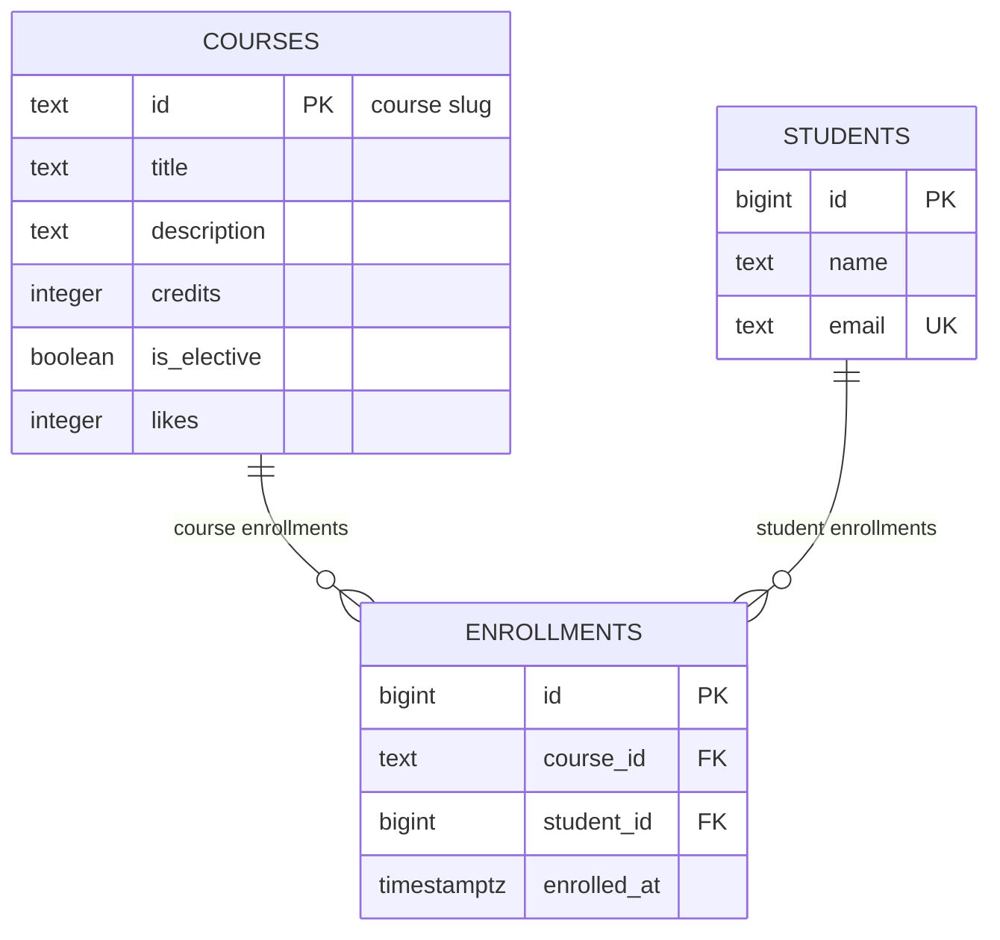

# course-catalog-db

PostgreSQL database schema for the Course Catalog project.  
Advanced Web Technologies — Lab 6.

This project stores courses, students, and enrollments in PostgreSQL. It demonstrates relational database design, constraints, SQL queries, error handling, indexes, and transactions.

## How to run

### Requirements

- PostgreSQL 16 or newer
- `psql` command-line client
- Git

### 1. Create the role and databases

Connect to PostgreSQL as the `postgres` superuser. Run these commands only if the role and databases do not already exist.

```sql
CREATE ROLE catalog_app LOGIN PASSWORD 'change-me';
CREATE DATABASE course_catalog OWNER catalog_app;
CREATE DATABASE idx_demo OWNER catalog_app;
```

If the role or databases already exist, do not create them again. Use the existing configuration.

### 2. Run the SQL files

Open a terminal in the project directory and execute:

```bash
psql -h localhost -p 5433 -U catalog_app -d course_catalog -v ON_ERROR_STOP=1 -f schema.sql
psql -h localhost -p 5433 -U catalog_app -d course_catalog -v ON_ERROR_STOP=1 -f seed.sql
psql -h localhost -p 5433 -U catalog_app -d course_catalog -v ON_ERROR_STOP=1 -f queries.sql
```

The `-v ON_ERROR_STOP=1` option stops execution when an SQL error occurs.

The schema and seed files can be rerun. `schema.sql` recreates the tables, so running it deletes existing table data. Run `seed.sql` after it to restore the initial dataset.

The expected initial data is:

- 6 courses
- 3 students
- 6 enrollments

The `experiments/idx_data.sql` file is used separately in the `idx_demo` database for the index performance experiment. It generates a large dataset and should not be run repeatedly without resetting the database.

The password shown above is an example for a teaching environment. Real credentials should not be committed to Git.

## Schema

### Entity Relationship Diagram



The database contains three tables: `courses`, `students`, and `enrollments`. The `enrollments` table connects students to courses through foreign keys. Courses and students can each have multiple enrollments, creating a many-to-many relationship between courses and students.

### Constraints

The schema uses the following rules:

- Primary keys uniquely identify records in all three tables.
- `NOT NULL` ensures that required fields contain values.
- `DEFAULT` supplies values for `is_elective`, `likes`, and `enrolled_at`.
- `CHECK` constraints require positive course credits, non-negative likes, and student names containing at least two characters.
- `UNIQUE` prevents duplicate student emails and duplicate course-student enrollment pairs.
- `ON DELETE RESTRICT` prevents deleting a course that has enrollments.
- `ON DELETE CASCADE` automatically deletes a student's enrollments when that student is deleted.
- An index on `enrollments.student_id` supports queries that find a student's enrollments.

## Design decisions

### 1. Why is `courses.id` a text slug while `students.id` is an automatically generated number?

A course slug, such as `modern-frontend`, is readable and can be used directly in URLs and API requests. Its disadvantage is that changing the slug requires updating references. A generated numeric student ID is compact, easy to create, and independent of the student's name or email. However, numeric IDs are less descriptive to humans.

### 2. Why use `RESTRICT` for courses but `CASCADE` for students?

A course should not be deleted while enrollments reference it, because this could remove important enrollment records unintentionally. Therefore, `ON DELETE RESTRICT` protects courses. When a student is deleted, their enrollments are dependent records that should no longer exist, so `ON DELETE CASCADE` removes them automatically.

### 3. Why use `timestamptz` instead of `timestamp`, and `text` instead of `varchar(n)`?

`timestamptz` stores a point in time and handles time-zone conversions, which is useful for enrollment timestamps. PostgreSQL's `text` type allows variable-length strings without an arbitrary length limit. A `varchar(n)` limit is useful only when a specific maximum length is a real business rule. Required values and domain restrictions are enforced separately through constraints.

## Constraint violation log

The experiments were performed using PostgreSQL verbose error output to identify SQLSTATE codes and constraint names. The API responses below describe how the application should handle the corresponding database errors.

| # | What we violate | SQLSTATE | Constraint | Expected API response |
|---|---|---|---|---|
| 1 | NULL in `courses.title` | `23502` | `NOT NULL` on `title` (column name) | `422 Unprocessable Entity` |
| 2 | `courses.credits = 0` | `23514` | `courses_credits_check` | `422 Unprocessable Entity` |
| 3 | `courses.likes = -1` | `23514` | `courses_likes_check` | `500 Internal Server Error` for an invalid internal counter update |
| 4 | A one-letter student name | `23514` | `students_name_check` | `422 Unprocessable Entity` |
| 5 | A duplicate student email | `23505` | `students_email_key` | `409 Conflict` |
| 6 | A duplicate course ID | `23505` | `courses_pkey` | `409 Conflict` |
| 7 | A repeated enrollment | `23505` | `enrollments_course_id_student_id_key` | `409 Conflict` |
| 8 | Enrollment in a nonexistent course | `23503` | `enrollments_course_id_fkey` | `404 Not Found` |
| 9 | Enrollment for a nonexistent student | `23503` | `enrollments_student_id_fkey` | `404 Not Found` |
| 10 | Deleting a course that has enrollments | `23001` on PostgreSQL 18; `23503` on PostgreSQL 16–17 | `enrollments_course_id_fkey` | `409 Conflict` |

For experiment 1, the `NOT NULL` violation is identified by the column name `title`, because PostgreSQL does not assign a separate named constraint to a `NOT NULL` column.

The API response for experiment 3 is different from ordinary user validation errors. The application should not decrement the likes counter below zero. If internal application logic causes this invalid update, it indicates a bug rather than an invalid user request.

The SQLSTATE for experiment 10 depends on the PostgreSQL version. PostgreSQL 18 reports `23001` for a deletion blocked by `RESTRICT`, while PostgreSQL 16 and 17 may report `23503`. The constraint name identifies the same relationship in either case.

### Cascading delete experiment

The `ON DELETE CASCADE` rule was tested inside a transaction so that the original data could be restored.

Initially, the database contained 6 enrollments. Deleting the student with email `dan​iyar@example.com` reduced the enrollment count from 6 to 3 because the student had three enrollments.

After executing `ROLLBACK`, the enrollment count returned to 6. This demonstrated that the cascade works and that the transaction can undo the deletion.

### Why validate data in both Pydantic and PostgreSQL?

Pydantic validates incoming API requests before they reach the database, providing clear validation errors to clients. Database constraints provide a second layer of protection because data may also be inserted or updated by scripts, other services, or direct SQL commands. Keeping the rules in both places helps preserve data integrity regardless of how the database is accessed.

## Index: EXPLAIN before and after

### Objective

The experiment compares query performance before and after creating an index on `enrollments.student_id`.

The experiment was performed in the separate `idx_demo` database with:

- 500 courses
- 20,000 students
- 50,000 enrollments

The test query was:

```sql
EXPLAIN ANALYZE
SELECT *
FROM enrollments
WHERE student_id = 777;
```

### Before the index

The index on `student_id` was removed before the first measurement.

```text
Seq Scan on enrollments
  (cost=0.00..1042.00 rows=3 width=34)
  (actual time=0.082..3.232 rows=3.00 loops=1)
  Filter: (student_id = 777)
  Rows Removed by Filter: 49997
  Buffers: shared hit=417
Planning:
  Buffers: shared hit=90
Planning Time: 2.194 ms
Execution Time: 3.306 ms
```

PostgreSQL used a sequential scan and checked the table rows to find the three matching enrollments.

### After the index

The index was created with:

```sql
CREATE INDEX enrollments_student_id_idx
ON enrollments (student_id);
```

The query plan changed to a bitmap index scan followed by a bitmap heap scan.

```text
Bitmap Heap Scan on enrollments
  (cost=4.31..15.59 rows=3 width=34)
  (actual time=0.067..0.069 rows=3.00 loops=1)
  Recheck Cond: (student_id = 777)
  Heap Blocks: exact=3
  Buffers: shared hit=6 read=2
  -> Bitmap Index Scan on enrollments_student_id_idx
       (cost=0.00..4.31 rows=3 width=0)
       (actual time=0.052..0.052 rows=3.00 loops=1)
       Index Cond: (student_id = 777)
       Index Searches: 1
       Buffers: shared hit=3 read=2
Planning:
  Buffers: shared hit=18 read=1 dirtied=3
Planning Time: 1.875 ms
Execution Time: 0.083 ms
```

### Results

| Metric | Before the index | After the index |
|---|---:|---:|
| Access method | Sequential Scan (`Seq Scan`) | Bitmap Heap Scan + Bitmap Index Scan |
| Estimated total cost | `1042.00` | `15.59` |
| Rows removed by filter | 49,997 | Not reported |
| Matching rows | 3 | 3 |
| Execution Time | 3.306 ms | 0.083 ms |

The measured execution time decreased from 3.306 ms to 0.083 ms, making this query approximately 39.8 times faster in this measurement.

### Answers to the questions

**1. Why did PostgreSQL not automatically create an index on `enrollments.student_id`?**

PostgreSQL automatically creates indexes for primary keys and unique constraints, but it does not automatically create indexes on foreign-key columns. The existing unique index on `(course_id, student_id)` is useful for searches by `course_id`, but it does not efficiently support searches by `student_id` alone because `student_id` is the second column.

**2. Why can a primary-key lookup on `courses` use `Seq Scan`, while a query on the large `enrollments` table uses an index?**

The `courses` table contains only six rows and can fit on a single data page. Reading the entire small table may be cheaper than using an index. The `enrollments` table contains 50,000 rows, so an index can avoid scanning the whole table and reduce the query cost.

**3. Name two operations that an index on `student_id` can speed up.**

The index can speed up queries that retrieve a student's enrollments, such as `SELECT` queries filtered by `student_id`. It can also help PostgreSQL locate a student's enrollment records when deleting that student with `ON DELETE CASCADE`.

### Conclusion

The experiment demonstrated that an index on a frequently queried foreign-key column can significantly reduce query execution time. However, indexes require storage and add overhead to insert, update, and delete operations, so they should be created for specific query patterns.

## Transaction

The transaction experiment demonstrates why inserting a student and enrolling them in a course should be treated as one logical operation.

### Scenario 1: An error causes the transaction to roll back

A transaction was started, and a new student, Madina Ospanova, was inserted successfully. The second insert attempted to enroll her in a nonexistent course, `no-such-course`.

The second insert failed because it violated the foreign-key constraint `enrollments_course_id_fkey`. PostgreSQL marked the transaction as aborted. Further commands were rejected until `ROLLBACK` was executed.

After the rollback, a query for `madina@example.com` returned a count of zero. The first insert was undone as well, so no student without a valid enrollment remained in the database.

### Scenario 2: Two successful inserts in two windows

In the successful variant, Window A began a transaction, inserted Madina Ospanova, and enrolled her in `web-security`. Both inserts succeeded, but the transaction remained uncommitted.

Window B queried the database before the commit and returned a count of zero for `madina@example.com`. Uncommitted changes were not visible to the second client.

Window A then executed `COMMIT`. When Window B repeated the query, it returned a count of one. Both the student and enrollment became visible together after the commit.

### Why transactions matter

Without a transaction, the first insert could remain in the database if the second insert failed. This would leave a student record without the intended enrollment. A transaction ensures that either both operations succeed or neither operation remains committed.

PostgreSQL's default `READ COMMITTED` isolation level allows a client to see committed changes from other transactions, while hiding their uncommitted changes.
